 

  

<a href="#-things-ive-launched"><b>🚀 PROJECTS</b></a> &nbsp;·&nbsp;
<a href="#%EF%B8%8F-my-contributions-as-a-city"><b>🏙️ SKYLINE</b></a> &nbsp;·&nbsp;
<a href="#-stats"><b>📊 STATS</b></a> &nbsp;·&nbsp;
<a href="#%EF%B8%8F-recently-shipped"><b>🛰️ SHIPPED</b></a> &nbsp;·&nbsp;
<a href="#-classified-mission-logs"><b>🔒 CLASSIFIED</b></a>

---


## 🚀 Things I've launched

<table>
<tr>
<td width="50%" valign="top">

<a href="https://mirror-city-delta.vercel.app">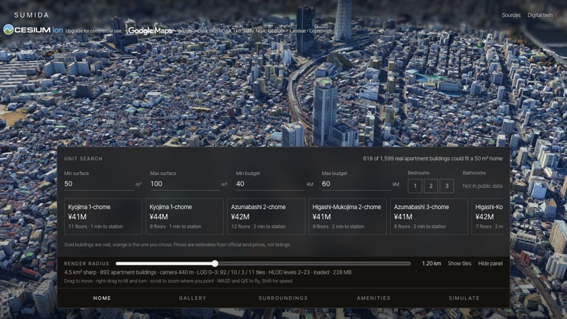</a>

### 🏙️ [Mirror City](https://github.com/Amritanshu-nirjhar/mirror-city)
A 3D **digital twin of Sumida, Tokyo** built entirely from open public data. Every building, the official flood and earthquake hazard maps, plus four simulations: river flood, evacuation, transit access and rooftop solar.

  

</td>
<td width="50%" valign="top">

<a href="https://odyssey-sable-nine.vercel.app">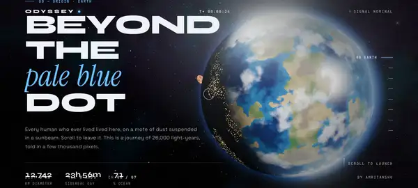</a>

### 🌌 [Odyssey](https://github.com/Amritanshu-nirjhar/Odyssey)
**Beyond the Pale Blue Dot.** A scroll-driven 3D journey from Earth to the event horizon of Sagittarius A*.

  

</td>
</tr>
<tr>
<td width="50%" valign="top">

<a href="https://pergamon-beta.vercel.app">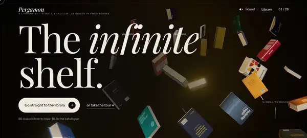</a>

### 📜 [Pergamon](https://github.com/Amritanshu-nirjhar/Pergamon)
A scroll-driven **3D library** of 66 public-domain classics. Browse the shelves, open a book and read it right in the browser.

 

</td>
<td width="50%" valign="top">

<a href="https://mars-satellites-alpha-orpin.vercel.app">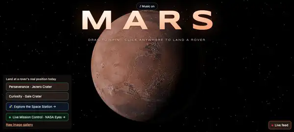</a>

### 🔴 [Rover](https://github.com/Amritanshu-nirjhar/Rover)
**Explore Mars.** Missions, stations, a gallery and 3D models of the red planet.

  

</td>
</tr>
<tr>
<td width="50%" valign="top">

<a href="https://abandoned-but-not-forgotten-neon.vercel.app">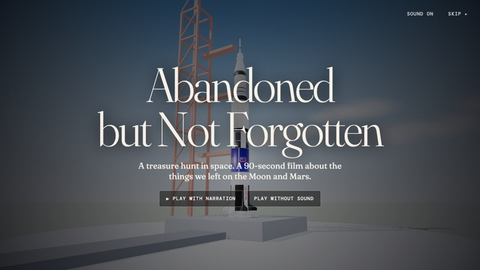</a>

### 🌑 [Abandoned But Not Forgotten](https://github.com/Amritanshu-nirjhar/abandoned-but-not-forgotten)
The story of the hardware **NASA left behind** on the Moon and Mars.

</td>
<td width="50%" valign="top">

<a href="https://air-pool-eta.vercel.app">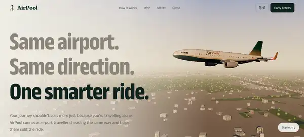</a>

### ✈️ [AirPool](https://github.com/Amritanshu-nirjhar/AirPool)
**Shared rides** from Delhi Airport T3 to Gurugram: a 3D journey, a matching engine, a booking demo and a waitlist.

</td>
</tr>
<tr>
<td width="50%" valign="top">

<a href="https://zero-pink-sigma.vercel.app">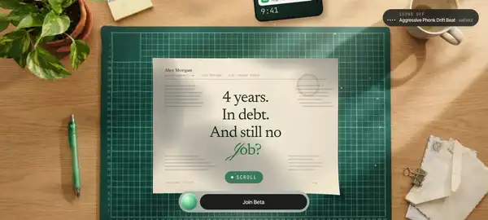</a>

### ⚡ [ZERO](https://github.com/Amritanshu-nirjhar/ZERO)
**Learn. Build. Get hired.**

 

</td>
<td width="50%" valign="top">

<a href="https://lila-worlds.vercel.app">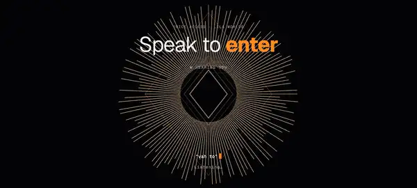</a>

### 🎮 [Lila Worlds](https://github.com/Amritanshu-nirjhar/lila-worlds)
Site for a Bengaluru studio building playable worlds, live in-game shows and VR for Fortnite, Roblox and Meta Quest.

</td>
</tr>
</table>

## 🛠️ Arsenal

  

## 🏙️ My contributions, as a city

  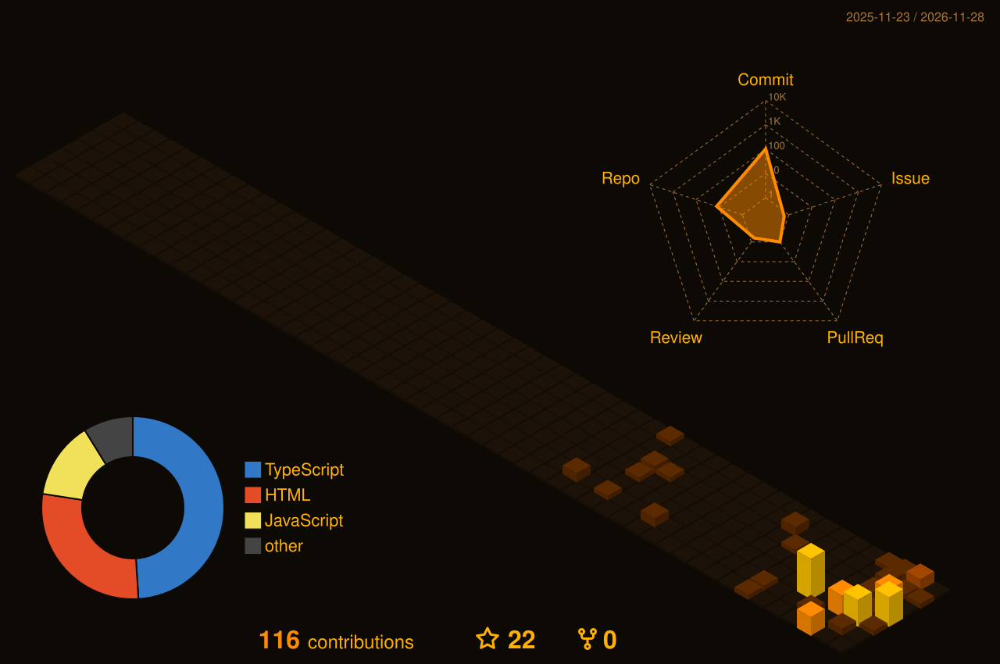

## 📊 Stats

  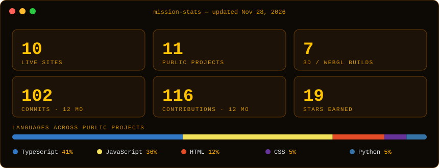

  

  

## 🛰️ Recently shipped

<!-- updated every 12 hours by .github/workflows/profile.yml -->
<!--RECENT:START-->
| pushed | project | what it is |
|:--|:--|:--|
| `Nov 26` | **[mirror-city](https://github.com/Amritanshu-nirjhar/mirror-city)** | A 3D digital twin of Sumida, Tokyo, built from open public data, with flood, evacuation, transit and solar simulations · [live ↗](https://mirror-city-delta.vercel.app) |
| `Nov 25` | **[amritanshu-portfolio](https://github.com/Amritanshu-nirjhar/amritanshu-portfolio)** | My portfolio: projects, hackathon wins and MUN, with a 3D dot-text hero. Next.js + React Three Fiber · [live ↗](https://amritanshu-portfolio-beryl.vercel.app) |
| `Nov 25` | **[lila-worlds](https://github.com/Amritanshu-nirjhar/lila-worlds)** | Studio site for Lila Worlds, a Bengaluru team building playable worlds for Fortnite, Roblox and Meta Quest. Speak to enter · [live ↗](https://lila-worlds.vercel.app) |
| `Nov 25` | **[ZERO](https://github.com/Amritanshu-nirjhar/ZERO)** | Learn. Build. Get hired. A career platform concept: pick a role, ship real-world projects, get matched with jobs · [live ↗](https://zero-pink-sigma.vercel.app) |
| `Nov 25` | **[Rover](https://github.com/Amritanshu-nirjhar/Rover)** | Explore Mars: missions, stations, a gallery and 3D models of the red planet · [live ↗](https://mars-satellites-alpha-orpin.vercel.app) |
<!--RECENT:END-->

## 🔒 Classified: mission logs

<b>Clearance granted. Click to open.</b>

 

| | log entry |
|:--:|:--|
| 🥇 | **1st place, E-Summit ’26** · eCell, Netaji Subhas University of Technology |
| 🏆 | **#4 of 860 teams, Hack Synapse 2026** · IEEE 36-hour national hackathon, the only first-year team in the top 16 |
| 🎯 | **Top 5, Product Paradox · INTERFACE ’26** · Department of Management, BITS Pilani |
| 🎙️ | **Chairperson & Executive Board, Model UN** · chairing committees from UNCSW to WHO across Delhi NCR since 2024 |
| 🎓 | **CSE @ Newton School of Technology, Rishihood University** · shipping real products on the side |

> Full dossier at the [portfolio ↗](https://amritanshu-portfolio-beryl.vercel.app)

## 🐍 Watch the snake eat my contributions

  <picture>
    <source media="(prefers-color-scheme: dark)" srcset="https://raw.githubusercontent.com/Amritanshu-nirjhar/Amritanshu-nirjhar/output/snake-dark.svg?v=2" />
    
  </picture>

